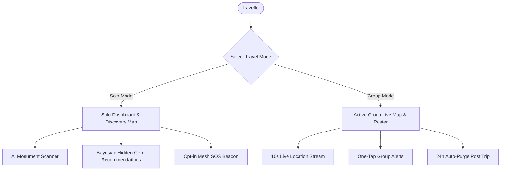
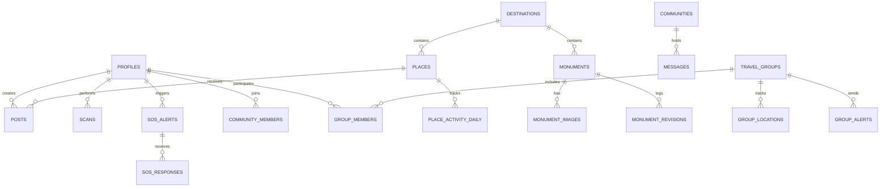

# Product Requirement Document (PRD) — WanderLens

**Product Name:** WanderLens  
**Category:** AI-Powered Heritage Tourism & Solo/Group Travel Coordination Platform  
**Target Platform:** Responsive Web & Progressive Web App (PWA)  
**Document Version:** 1.0.0  
**Status:** Implemented & Production-Ready  
**Last Updated:** November 2026  

---

## Table of Contents
1. [Executive Summary & Product Vision](#1-executive-summary--product-vision)
2. [Target Personas & Travel Modes](#2-target-personas--travel-modes)
3. [System Architecture & Technology Stack](#3-system-architecture--technology-stack)
4. [Functional Feature Specifications](#4-functional-feature-specifications)
   - [4.1 Feature 1: AI Monument Recognition & Historical Comparison](#41-feature-1-ai-monument-recognition--historical-comparison)
   - [4.2 Feature 2: Bayesian Hidden Gem Recommendation Engine](#42-feature-2-bayesian-hidden-gem-recommendation-engine)
   - [4.3 Feature 3: Live Group Travel Coordination](#43-feature-3-live-group-travel-coordination)
   - [4.4 Feature 4: Solo Emergency SOS Mesh Network](#44-feature-4-solo-emergency-sos-mesh-network)
   - [4.5 Feature 5: Destination Community Hubs & Social Discovery Feed](#45-feature-5-destination-community-hubs--social-discovery-feed)
   - [4.6 Feature 6: Administration & Content Moderation Suite](#46-feature-6-administration--content-moderation-suite)
5. [UI/UX Design System Specifications](#5-uiux-design-system-specifications)
6. [Database Architecture & Schema Design](#6-database-architecture--schema-design)
7. [Backend Architecture, Microservices & API Specifications](#7-backend-architecture-microservices--api-specifications)
8. [Security, Privacy & Compliance Specifications](#8-security-privacy--compliance-specifications)
9. [Mathematical Formulations & Algorithms](#9-mathematical-formulations--algorithms)
10. [Non-Functional Requirements & Performance Metrics](#10-non-functional-requirements--performance-metrics)
11. [Traceability & Verification Matrix](#11-traceability--verification-matrix)

---

## 1. Executive Summary & Product Vision

### 1.1 Executive Summary
**WanderLens** is an end-to-end travel and cultural heritage platform engineered to bridge visual monument exploration with real-time travel safety and group coordination. It allows travellers to point their camera at heritage landmarks to receive instant AI identification with side-by-side archival comparisons, discover authentic low-crowd cultural destinations through a transparent Bayesian algorithm, coordinate group journeys via live map telemetry, and broadcast emergency SOS alerts over an ephemeral, privacy-preserving mesh network.

### 1.2 Problem Statement
1. **Information Scarcity at Heritage Landmarks:** Travellers visiting cultural heritage sites frequently encounter monuments without contextual narrative, relying on damaged or missing physical signage.
2. **Tourist Overcrowding vs. Undiscovered Culture:** Ad-driven recommendation algorithms continually promote the same commercial spots, ignoring authentic regional culture and hidden gems.
3. **Safety Vulnerabilities in Solo Travel:** Solo travellers, especially in unfamiliar regions, lack fast, localized safety nets that preserve personal privacy without constant invasive tracking.
4. **Group Travel Coordination Friction:** Managing group journeys often results in fragmented communication across chat apps, separate GPS tracking utilities, and lingering location trails after trips conclude.

### 1.3 Key Value Propositions
* **AI Visual Discovery:** Microservice-driven CLIP vector similarity matching with GPS prior boosting.
* **Explainable Recommendations:** Mathematical Bayesian confidence scoring combined with 30-day activity percentile penalties.
* **Privacy by Design:** PostGIS coordinate quantization (~100m coarse jitter) for emergency broadcasts, zero-EXIF client policy, and 24-hour post-trip group location purges.
* **Dual Operating Modes:** Dedicated Solo Mode (discovery, safety, feeds) and Group Mode (shared itineraries, member telemetry, quick alerts).

---

## 2. Target Personas & Travel Modes

### 2.1 User Personas
* **The Heritage Explorer (Solo Traveller):** Seeks architectural history, archival photography, authentic local food, and off-the-beaten-path cultural landmarks without tourist crowds.
* **The Social Backpacker:** Relies on community channels, peer recommendations, and safety nets when exploring unfamiliar cities.
* **The Group Trip Organizer:** Leads friend or family expeditions, requiring real-time situational awareness of all members on a shared map with fast alerting.
* **Community Moderator & Heritage Curator:** Verifies historical accuracy, curates monument revision history, and ensures community standards.

### 2.2 Dual Travel Modes
The platform introduces an intuitive mode switcher (`/mode-select`):
* **Solo Mode:** Optimized for personal exploration. Features the Bayesian discovery map, AI monument scanning, community reviews, and the emergency peer SOS beacon.
* **Group Mode:** Tailored for travel groups. Displays a synchronized live map with real-time member pins, distance telemetry, group alert triggers (*"Need Help"*, *"Regroup"*, *"Custom"*), and automatic data purge upon trip conclusion.

---

## 3. System Architecture & Technology Stack

```mermaid
flowchart LR
    subgraph Client["Frontend Client (Next.js 16 + React 19)"]
        UI[Tailwind CSS v4 + Framer Motion]
        Maps[Leaflet + React-Leaflet Map Engine]
        SSR[Supabase SSR / Server Components]
    end

    subgraph Backend["Next.js App Router API & Middleware"]
        API[Edge & Node Route Handlers]
        MW[Session Middleware & Route Guards]
        Ranking[Deterministic Bayesian Ranking]
    end

    subgraph Microservice["Python FastAPI (Port 8000)"]
        CLIP[OpenAI CLIP ViT-B/32 Model]
        Torch[PyTorch Tensor Operations]
    end

    subgraph Data["Supabase (PostgreSQL 15+)"]
        PostGIS[(PostGIS: Spatial Geometry & Geography)]
        Vector[(pgvector: IVFFlat 512D Embeddings)]
        Trgm[(pg_trgm: Fuzzy Search)]
        RLS[Row Level Security on 23 Tables]
        Storage[Supabase Object Storage]
    end

    Client --> MW --> API
    API --> Microservice
    API --> Data
    Microservice --> Data
```

### 3.1 Technology Stack Details
* **Frontend Web Framework:** Next.js 16.4.2 (App Router), React 19.3.0, TypeScript 5.
* **Styling & Motion:** Tailwind CSS v4, Framer Motion 14, Lucide React icons.
* **Geospatial & Mapping:** Leaflet 1.9.4 & React-Leaflet 5.0 with custom CartoDB dark/editorial vector basemaps.
* **Computer Vision Microservice:** Python 3.10+, FastAPI, Hugging Face Transformers (`openai/clip-vit-base-patch32`), PyTorch, PIL, NumPy.
* **Database & BaaS:** Supabase PostgreSQL with PostGIS, `pgvector`, and `pg_trgm` extensions; Supabase Auth (`@supabase/ssr`).
* **Validation & Security:** Zod 4, strict typed database schemas, zero-EXIF client stripping, Supabase RLS.

---

## 4. Functional Feature Specifications

### 4.1 Feature 1: AI Monument Recognition & Historical Comparison
* **User Workflow:**
  1. User navigates to `/scan` and uploads or snaps a monument photo.
  2. Device GPS coordinates are optionally attached to the multipart form payload.
  3. The request routes to `POST /api/scan` and forwards the image to the FastAPI microservice (`/recognize`).
  4. The microservice encodes the image into a 512-dimensional vector embedding using `CLIPModel.from_pretrained("openai/clip-vit-base-patch32")`.
  5. The embedding is compared against reference vectors in `monument_images` using cosine distance.
  6. **GPS Prior Boosting:** If user GPS is provided, monuments within 5,000 meters receive a `+0.05` cosine similarity boost:
     $$\text{Score} = \min(1.0, \text{Cosine Sim} + 0.05)$$
  7. **Decision Thresholds:**
     * **Confidence $\ge 0.75$:** Immediate match. Renders the monument profile, historical timeline, builder, architectural style, and side-by-side archival image comparison.
     * **Confidence $< 0.75$:** Candidate matching. Returns the top 3 closest monuments for user selection.
  8. **Fallback Engine:** If the Python microservice is offline, the Next.js API executes a local fallback based on monument name tokens and GPS proximity, ensuring smooth testing across local environments.
  9. **Archival Image Licensing:** Historical images render with author attribution, source link, and license type.

### 4.2 Feature 2: Bayesian Hidden Gem Recommendation Engine
* **Purpose:** Surfaces high-quality, authentic places with low crowd density.
* **Source:** Implemented in `src/lib/recommendations/ranking.ts` and database RPC `get_recommendations`.
* **Formula & Logic:**
  $$\text{Raw Activity} = \text{Posts}_{30d} + 2 \times \text{Checkins}_{30d} + 0.2 \times \text{Likes}_{30d} + 0.5 \times \text{Comments}_{30d}$$
  $$\text{Activity Norm} = \text{Percentile Rank}(\text{Raw Activity}) \in [0, 1]$$
  $$\text{Confidence Score} = \frac{\text{Rating} \times N + 4.0 \times 5}{N + 5}$$
  $$\text{Score} = \text{Confidence Score} - 0.5 \times \text{Activity Norm}$$
* **Qualification Criteria for "Hidden Gem":**
  * Average rating $\ge 3.8$ stars.
  * Rating count $N \ge 3$.
  * Activity percentile $\text{Activity Norm} \le 0.50$ (lower 50th percentile of crowd volume).
* **Explainability:** Generates human-readable descriptions (e.g., *"Hidden gem — exceptional 4.8★ reviews with 80% lower crowd density"*).

### 4.3 Feature 3: Live Group Travel Coordination
* **Purpose:** Real-time member location tracking and safety alerting for group expeditions.
* **Key Mechanics:**
  * **Membership & State:** Groups feature states (`active`, `ended`, `cancelled`). Members transition through `invited` $\rightarrow$ `accepted` $\rightarrow$ `left`.
  * **Location Streaming:** Active members update coordinates every 10 seconds (`POST /api/groups/:id/locations`).
  * **Single Latest Point:** Only the latest location per member is stored via an upsert pattern in `group_locations`.
  * **Group Alerts:** Members can broadcast instant alerts:
    * `need_help`: Immediate assistance call to group mates.
    * `regroup`: Call to assemble at a designated pin.
    * `custom_message`: Free-form contextual alert.
  * **Privacy Guarantee:** When a group reaches `ends_at` or status `ended`, a background cron job (`/api/cron/purge-locations`) permanently purges all location rows after 24 hours.

### 4.4 Feature 4: Solo Emergency SOS Mesh Network
* **Purpose:** Fast peer-to-peer safety beacon for solo travellers in distress.
* **Key Mechanics:**
  * **Opt-In Presence:** Travellers toggle SOS participation in their profile.
  * **Location Quantization (Privacy):** Coordinates are rounded to 3 decimal places (~100m precision at equator). Exact coordinates are never persisted.
  * **Presence TTL:** Ephemeral presence records auto-expire after 30 minutes unless refreshed.
  * **Geofence Matching:** When triggered (`POST /api/sos`), PostGIS function `create_sos_alert` queries opted-in, verified users within a 2,000m radius using `ST_DWithin`.
  * **Mutual Blocking Filter:** Automatically excludes users with bidirectional block records.
  * **Rate Limiting:** Maximum 3 SOS alerts per user per rolling hour to prevent panic spam or denial-of-service.
  * **Live Helper Acknowledgment:** Responders tap *"I am responding"*, notifying the sender with live responder counts and profile cards.

### 4.5 Feature 5: Destination Community Hubs & Social Discovery Feed
* **Community Hubs:** Destination-specific rooms (e.g., Varanasi, Jaipur, Hampi) with real-time Supabase messaging.
* **Social Feed:** Posts with up to 4 images, star ratings (1–5), captions (up to 500 characters), likes, and comments.
* **Rate Limits:** Chat messages limited to 20 messages/minute.

### 4.6 Feature 6: Administration & Content Moderation Suite
* **Role Hierarchy:** `traveller` (default), `moderator`, `admin`.
* **Moderation Queue:** Flagged items (`post`, `comment`, `message`, `user`) can be reviewed, marked resolved, hidden, or result in user suspension.
* **Monument Versioning:** Revisions to historical text are logged in `monument_revisions` with editor attribution and rollback capability.
* **Immutable Audit Log:** Administrative actions (role changes, bans, deletions) trigger automatic writes to `audit_log`.

---

## 5. UI/UX Design System Specifications

### 5.1 Design Aesthetics & Theme
* **Theme Identity:** Luxury Digital Travel Magazine & Editorial Cartography.
* **Color Palette:**
  * Background: `#101B2B` (Midnight Navy)
  * Surface / Cards: `#1E293B` / `#162235` (Slate Night)
  * Text / Headers: `#F5F0E7` (Parchment White)
  * Secondary Text: `#94A3B8` (Cool Grey)
  * Primary Accent: `#D97706` / `#B45309` (Heritage Amber / Terracotta)
  * Emergency Accent: `#DC2626` / `#EF4444` (SOS Crimson)
  * Success / Safe: `#10B981` (Emerald)

### 5.2 Key Screens & Experiences
1. **Cinematic Hero (`/`):** Full-viewport backdrop with magazine editorial typography, Brand Story, Interactive Map preview, Solo vs Group highlights, and Interactive Subcontinent Globe exploration.
2. **Mode Switcher (`/mode-select`):** Clean split-screen choice between Solo Exploration and Group Expedition modes.
3. **Solo Dashboard (`/solo`):** Interactive Leaflet map featuring category filtering (heritage, food, nature, viewpoint, market, culture), Bayesian hidden gem score badges, and detailed sliding modal cards.
4. **Live Monument Scanner (`/scan`):** Viewfinder with file drag-and-drop, camera shutter, real-time confidence readout, and archival split comparison slider.
5. **Group Live Map (`/groups/[id]`):** Real-time multi-avatar tracking on CartoDB map, member telemetry cards, and one-tap emergency and regroup dispatchers.
6. **Emergency Beacon Screen (`/sos`):** High-visibility crimson tactile button with 3-second hold prevention, live radar circle showing verified responders within 2km, and responder roster.
7. **Destination Community Chat (`/communities/[id]`):** Real-time chat feed with sender verification badges, message reporting, and member counts.

---

## 6. Database Architecture & Schema Design

### 6.1 Database Schema (23 Tables across Supabase PostGIS)

#### Core Table Definitions:
1. `profiles`: Extended user profile linked to `auth.users(id)`. Contains `role` (`traveller`, `moderator`, `admin`), `is_verified`, `sos_opt_in`, and `suspended_until`.
2. `destinations`: Major travel regions (e.g., Jaipur, Varanasi) with PostGIS `centre` point.
3. `places`: Cultural landmarks, food spots, viewpoints, with `category`, PostGIS `location`, `avg_rating`, and `is_hidden`.
4. `place_activity_daily`: 30-day rolling activity metrics (`posts`, `checkins`, `likes`, `comments`) feeding the Bayesian ranking engine.
5. `monuments`: Heritage sites with architectural data, `history_text`, and versioning.
6. `monument_images`: Reference and archival images with 512-dim `vector(512)` embeddings indexed via `ivfflat`.
7. `monument_revisions`: Edit audit history for monument historical copy.
8. `scans`: Historical user scan records with confidence scores.
9. `travel_groups`: Group trips with `starts_at`, `ends_at`, and `status`.
10. `group_members`: Member status (`invited`, `accepted`, `left`) and `sharing_on` flag.
11. `group_locations`: Single latest PostGIS coordinate per member.
12. `group_alerts`: Fast group notifications (`need_help`, `regroup`, `custom_message`).
13. `user_presence`: Ephemeral 30-minute PostGIS coarse points for verified SOS opt-ins.
14. `sos_alerts`: Emergency alerts with 200-char note and recipient tally.
15. `sos_responses`: Nearby helpers who have acknowledged an emergency.
16. `communities` & `community_members`: Discussion channels by destination.
17. `messages`: Real-time chat messages.
18. `posts`, `post_images`, `post_likes`, `comments`: User-generated social discovery feed.
19. `blocks`: Mutual blocking table preventing chat, visibility, and SOS routing.
20. `reports`: Moderation flag tracking with status (`open`, `resolved`).
21. `audit_log`: System-wide immutable security and administrative log.

### 6.2 Key Database Functions & Triggers
* `get_recommendations(p_destination_id, p_category, p_sort)`: Database-level calculation of Bayesian scores and percentile crowd ranks.
* `update_user_presence(p_lat, p_lng)`: Coarse coordinate quantization to 3 decimal places with 30-minute expiry.
* `create_sos_alert(p_lat, p_lng, p_note)`: Radius query (`ST_DWithin` 2000m) with blocklist filtering and rate limit validation.
* `purge_expired_group_locations()`: Automated deletion of group telemetry 24 hours post-trip.

---

## 7. Backend Architecture, Microservices & API Specifications

### 7.1 Architecture Layers
1. **Next.js App Router (Port 3000):** Hosts server components, route handlers, and middleware for session persistence.
2. **FastAPI Recognition Microservice (Port 8000):** Standalone Python service hosting PyTorch and the CLIP ViT-B/32 neural network.
3. **Supabase PostgreSQL & PostGIS:** Persistent relational storage, vector indexing, real-time channels, and storage buckets.

### 7.2 API Route Specifications

| Method | Endpoint | Access Level | Description |
| :--- | :--- | :--- | :--- |
| `POST` | `/api/scan` | Public / Auth | Submits photo & GPS for CLIP monument identification |
| `GET` | `/api/destinations/:id/recommendations` | Public | Fetches Bayesian ranked places with category filters |
| `GET` | `/api/groups` | Authenticated | Lists user's active, upcoming, and past travel groups |
| `POST` | `/api/groups` | Authenticated | Creates a new travel group with start and end dates |
| `POST` | `/api/groups/:id/locations` | Group Member | Streams user's live coordinates (rate limited to 10s) |
| `POST` | `/api/groups/:id/alerts` | Group Member | Dispatches emergency or regroup alert to group |
| `POST` | `/api/groups/:id/sharing` | Group Member | Toggles location sharing state on/off |
| `GET` | `/api/sos` | Authenticated | Fetches active personal SOS and nearby incoming alerts |
| `POST` | `/api/sos` | Authenticated | Broadcasts an emergency SOS within a 2 km radius |
| `POST` | `/api/sos/presence` | Authenticated | Updates ephemeral coarse presence for SOS network |
| `POST` | `/api/sos/:id/respond` | Authenticated | Marks current user as a responder to an active SOS |
| `GET` | `/api/posts` | Public | Fetches paginated community discovery feed |
| `POST` | `/api/posts` | Authenticated | Publishes travel post (up to 4 images, rating 1–5) |
| `POST` | `/api/communities/:id/messages` | Community Member| Sends chat message (rate limited to 20/min) |
| `POST` | `/api/reports` | Authenticated | Submits moderation report against user, post, or message|
| `POST` | `/api/cron/purge-locations` | Cron / Secret | Purges location records for groups ended $>24$ hrs ago |

---

## 8. Security, Privacy & Compliance Specifications

### 8.1 Row-Level Security (RLS) Matrix
Every table in the database has RLS enforced:
* **Profiles:** Public can view basic information; users can only edit their bio and avatar; role elevation is restricted to database triggers or admin users.
* **Group Telemetry:** Only active members of an active group can view location coordinates.
* **SOS Broadcasts:** Coarse coordinates visible only to verified, opted-in responders within the 2,000m radius who are not blocked by the sender.
* **Admin Actions:** Direct mutation of destinations, places, or moderation reports requires `is_admin()` or `is_moderator_or_admin()`.

### 8.2 Privacy by Design
1. **Coarse GPS Quantization:** SOS coordinates are rounded to 3 decimal places:
   $$\text{Lat}_{\text{coarse}} = \text{round}(\text{Lat}, 3), \quad \text{Lng}_{\text{coarse}} = \text{round}(\text{Lng}, 3)$$
   This provides approximately 110-meter neighborhood accuracy, protecting exact user coordinates.
2. **Zero EXIF Retention:** Uploaded images have metadata stripped on the client before submission.
3. **Data Lifecycle Purging:** Group location data is destroyed 24 hours after a trip concludes.

### 8.3 Rate Limiting & Abuse Prevention
* **SOS Beacon Limit:** Maximum 3 alerts per rolling 60 minutes.
* **Community Chat Limit:** Maximum 20 messages per minute.
* **File Upload Controls:** Strict whitelist (`image/jpeg`, `image/png`, `image/webp`), 5 MB cap, and 4 images per post maximum.

---

## 9. Mathematical Formulations & Algorithms

### 9.1 Visual Monument Recognition (CLIP Vector Embedding & GPS Prior)
Given an uploaded image $I$ and candidate monument reference images $\{R_1, R_2, \dots, R_m\}$:
$$v_I = \frac{\text{CLIP}(I)}{\|\text{CLIP}(I)\|}, \quad v_{R_j} = \frac{\text{CLIP}(R_j)}{\|\text{CLIP}(R_j)\|}$$
The base visual cosine similarity is:
$$\text{Sim}(I, R_j) = v_I \cdot v_{R_j}$$
When user GPS coordinates $(lat_u, lon_u)$ are present and monument coordinates are $(lat_m, lon_m)$, distance $d(u, m)$ is computed via the Haversine formula. The final confidence score is:
$$\text{Confidence}(I, R_j) = \min\left(1.0, \text{Sim}(I, R_j) + 0.05 \cdot \mathbf{1}_{\{d(u, m) \le 5000\text{m}\}}\right)$$

### 9.2 Bayesian Hidden Gem Ranking Algorithm
For any place $p$ with average rating $R$, rating count $N$, and global prior rating $\mu = 4.0$ with smoothing constant $K = 5$:
$$\text{Confidence Score}(p) = \frac{R \cdot N + \mu \cdot K}{N + K}$$
The 30-day raw activity $A_{raw}(p)$ is computed as:
$$A_{raw}(p) = \text{Posts}_{30d} + 2 \cdot \text{Checkins}_{30d} + 0.2 \cdot \text{Likes}_{30d} + 0.5 \cdot \text{Comments}_{30d}$$
The percentile rank across all places in destination $D$ is:
$$A_{norm}(p) = \frac{\sum_{i \in D} \mathbf{1}_{\{A_{raw}(i) < A_{raw}(p)\}} + 0.5 \cdot \left(\sum_{i \in D} \mathbf{1}_{\{A_{raw}(i) = A_{raw}(p)\}} - 1\right)}{|D| - 1}$$
The final recommendation score with activity penalty weight $W = 0.5$ is:
$$\text{Score}(p) = \text{Confidence Score}(p) - W \cdot A_{norm}(p)$$

---

## 10. Non-Functional Requirements & Performance Metrics

* **Monument Recognition Latency:** End-to-end identification under 1.8 seconds on GPU, under 4.0 seconds on CPU fallback.
* **Tile & Map Rendering:** Interactive Leaflet maps load initial vector tiles in $<500\text{ ms}$.
* **Real-Time Telemetry:** Group location updates deliver to peer map instances within 500 ms via Supabase Realtime WebSocket subscriptions.
* **Mobile Responsiveness:** 100% responsive across mobile, tablet, and desktop viewports, with native PWA manifest support.

---

## 11. Traceability & Verification Matrix

| Requirement Dimension | Implementation Status | Key Reference Files |
| :--- | :--- | :--- |
| **Dual Travel Modes** | Complete | `src/app/mode-select/page.tsx`, `src/components/solo/SoloDashboard.tsx`, `src/components/groups/GroupsClient.tsx` |
| **AI Monument Scanner** | Complete | `recognition-service/main.py`, `src/app/api/scan/route.ts`, `src/components/scan/ScanClient.tsx` |
| **Bayesian Recommendations**| Complete | `src/lib/recommendations/ranking.ts`, `src/lib/recommendations/ranking.test.ts`, `supabase/migrations/001_schema.sql` |
| **Group Live Tracking** | Complete | `src/components/groups/GroupLiveMapClient.tsx`, `src/app/api/groups/route.ts` |
| **Solo SOS Network** | Complete | `supabase/migrations/006_sos_functions.sql`, `src/components/sos/SosClient.tsx`, `src/app/api/sos/route.ts` |
| **Moderation & Security** | Complete | `supabase/migrations/002_rls.sql`, `src/components/moderator/ModeratorClient.tsx`, `src/components/admin/AdminClient.tsx` |

