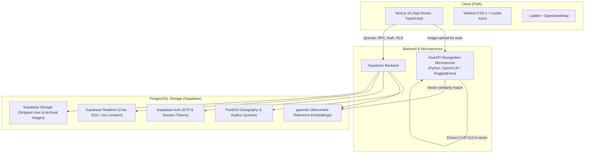

# 🏛️ WanderLens

> **Scan monuments, discover hidden gems, and travel safely with trusted groups and nearby-traveller SOS.**

[](https://github.com/ayyush-for-you/WanderLens)
[](https://github.com/ayyush-for-you/WanderLens)
[](https://github.com/ayyush-for-you/WanderLens)
[](https://supabase.com/)
[](LICENSE)

---

## 📖 Overview

**WanderLens** is a mobile-first travel companion web application (PWA) tailored for heritage destinations. Designed with transparency, privacy, and safety at its core, WanderLens bridges the gap between educational monument exploration, fair community discovery, and on-ground traveller safety.

### 🎯 Key Problems Solved
1. **Thin Context at Monuments:** Physical signboards are minimal, and commercial guides can be expensive or inconsistent. WanderLens identifies curated heritage monuments and provides verified architectural history alongside archival imagery.
2. **Algorithmic Bias Toward Commercial Spots:** Mainstream platforms prioritize crowded tourist traps. WanderLens uses a transparent, rule-based algorithm to highlight high-rated, low-activity "hidden gems".
3. **Absence of On-Ground Traveller Safety Nets:** Solo travellers lack quick community-based help channels, and travel groups juggle disconnected tools for itineraries, maps, and safety alerts.

### 🚫 Non-Goals & Scope Boundaries
* **Emergency Services:** The SOS feature **does not** contact police or state emergency services; it solely alerts opted-in, verified app users within a 2 km radius.
* **Monument Catalogue:** Recognition covers a curated set of 5–10 heritage monuments (with vector embeddings), not arbitrary world landmarks.
* **Transparent Scoring:** Place recommendations use an auditable mathematical rule rather than opaque black-box machine learning.
* **No Commercial Bloat:** No bookings, ticketing, or payment gateways.
* **Mobile-First Web:** Built as an installable Progressive Web App (PWA) rather than a native app store binary.

---

## ✨ Features

### 0. Authentication & Verification
* **Email + OTP Verification:** Travellers must verify their email before accessing social or safety features (chat, groups, posting, SOS). Unverified users retain read-only browsing.
* **Role-Based Access Control (RBAC):**
  * `traveller`: Browse, scan, post, join communities, chat, create groups, and broadcast/respond to SOS.
  * `moderator`: Review reported content (posts, comments, messages, users), apply warnings/suspensions, and edit/version monument texts.
  * `admin`: Complete platform control (RBAC assignments, destination/monument/place catalogues, metrics).
* Enforced strictly at the database level via **PostgreSQL Row Level Security (RLS)** and verified on API routes.

### 1. Solo & Group Travel Modes
* **1A. Group Mode (Trip Window & Ephemeral Locations):**
  * Groups feature a defined trip window (`starts_at` to `ends_at`).
  * Explicit, opt-in live location sharing displayed on a shared Leaflet/OpenStreetMap view.
  * Clear visual indicator: *"You are sharing your location"*, with instant 1-tap pause/resume.
  * Auto-termination of location broadcasting upon trip completion or member departure; location histories are purged within 24 hours.
  * Member alerts: `need_help`, `regroup`, `custom_message`.
* **1B. Solo Mode (Nearby SOS Network):**
  * **Opt-in Only:** Coarse presence stored (rounded to ~100m, 30-minute expiry window, active only while the app is in use).
  * Triggers an SOS alert with an optional note to opted-in, verified users within a **2 km radius**.
  * Recipients view distance, note, and timestamp with two options: **"I can help"** (reveals sender location) or **"Dismiss"**.
  * Rate-limited to **3 SOS broadcasts per user per hour** to prevent abuse.
  * Explicit disclaimer displayed: *"This alerts nearby app users only. It does not contact emergency services."* along with a direct call shortcut to local emergency numbers.

### 2. Monument Scanning & Historical Context
* Snap a photo or upload an image to identify monuments using **CLIP image embeddings** (`openai/clip-vit-base-patch32`) and nearest-neighbour cosine search via `pgvector`.
* Displays architectural style, construction year, builder/dynasty, and curated 150–300 word historical briefs.
* **Archival Imagery:** Displays public domain / openly licensed historical photos/paintings sourced from Wikimedia Commons with full author credit, license, and source links.
* **AI Impressions (Collapsed):** Any speculative AI architectural reconstructions are strictly housed in an opt-in, collapsed dropdown labelled: *"AI impression, not a historical record"*.
* Fallback mechanism: Returns top-3 candidate suggestions and manual search if matching confidence drops below threshold. Optional GPS prior gives monuments within 5 km a score boost (+0.05).

### 3. "Hidden Gem" Recommendation Engine
* Surfaces underrated places across categories: `heritage`, `food`, `nature`, `viewpoint`, `market`, `culture`, `other`.
* **Auditable Ranking Formula:**
  $$\text{confidence} = \frac{n_{\text{ratings}}}{n_{\text{ratings}} + K} \quad (K = 5)$$
  $$\text{activity}_{\text{raw}} = \text{posts}_{30d} + 2 \times \text{checkins}_{30d} + 0.2 \times \text{likes}_{30d} + 0.5 \times \text{comments}_{30d}$$
  $$\text{activity}_{\text{norm}} = \text{percentile\_rank}(\text{activity}_{\text{raw}} \text{ within destination})$$
  $$\text{score} = \left(\frac{\text{avg\_rating}}{5}\right) \times \text{confidence} - (W \times \text{activity}_{\text{norm}}) \quad (W = 0.5)$$
  $$\text{Eligibility Criteria: } \text{avg\_rating} \ge 3.8 \;\land\; n_{\text{ratings}} \ge 3 \;\land\; \text{activity}_{\text{norm}} \le 0.5$$
* User-facing transparency: Cards explicitly state why they are recommended (e.g., *"Rated 4.6 by 12 travellers, only 3 posts this month"*).

### 4. Community Travel Posts
* Place-tagged reviews featuring 1–4 photos, rating (1–5 stars), and caption (up to 500 characters).
* Automatic EXIF/GPS metadata stripping on upload to safeguard traveller privacy.
* Single-rating deduplication: Only the latest rating per user per place factors into `avg_rating`.
* Feed engagement directly updates 30-day activity tracking.

### 5. Communities, Realtime Chat & Moderation
* Destination-specific community hubs with realtime messaging.
* **Consent-based Group Conversion:** Community admins can spin off a travel group by sending invitations; users are never enrolled in location sharing without explicit consent.
* Immediate bidirectional user blocking (prevents direct messages, hides shared chats, and prohibits shared group placement).
* Full moderation ticket pipeline with action logging (`dismiss`, `hide`, `warn`, `suspend`).

---

## 🛠️ Tech Stack & Architecture



| Layer | Technology | Purpose |
|---|---|---|
| **Frontend** | Next.js 16 (TypeScript, React 19), Tailwind CSS 4 | Mobile-first responsive Progressive Web App (PWA) |
| **Maps** | Leaflet, OpenStreetMap | Interactive, privacy-respecting maps without commercial API costs |
| **Database & Auth**| Supabase (PostgreSQL 15+) | Row Level Security (RLS), Email OTP Auth, Realtime Channels |
| **Spatial Extensions**| PostGIS & pgvector | Geofencing (2 km SOS, 5 km GPS prior) & 512-dim CLIP similarity |
| **Recognition Service**| Python 3.10+, FastAPI, OpenCLIP | Lightweight vector embedding extraction microservice (`openai/clip-vit-base-patch32`) |
| **Asset Storage**| Supabase Storage | User uploads (EXIF-stripped) and historical monument archives |
| **Testing** | Node.js Test Runner, Pytest, Playwright | Unit ranking tests, RLS policy tests, and microservice tests |

---

## 🗄️ Database Schema Overview

All tables use `UUID` primary keys, snake_case naming, and automatic `created_at` / `updated_at` timestamps:

```
├── profiles                # Auth user metadata, role (traveller/moderator/admin), OTP status, SOS opt-in
├── destinations            # Heritage cities (e.g., Delhi, Jaipur) with PostGIS centre point
├── places                  # Spots within destinations, categories, rating aggregates, is_seeded
├── place_activity_daily    # Daily rolled-up activity (posts, checkins, likes, comments)
├── monuments               # Curated heritage monuments, architecture details, history text
├── monument_images         # Archival & reference images, license metadata, 512-d vector embeddings
├── monument_revisions      # Version history for monument textual descriptions
├── scans                   # Audit trail of monument scan queries and matched confidence
├── posts                   # Travel posts, ratings (1-5), captions, moderation flags
├── post_images             # Stripped user images linked to posts
├── communities             # Destination communities
├── community_members       # Verified members and roles
├── messages                # Realtime chat messages
├── travel_groups           # Active trip entities with trip window (starts_at -> ends_at)
├── group_members           # Group participation and location sharing toggle
├── group_locations         # Ephemeral latest point per active member (purged post-trip)
├── group_alerts            # Intragroup alert pings (need_help, regroup, custom)
├── user_presence           # Coarse ~100m location with 30m TTL for SOS opt-in travellers
├── sos_alerts              # SOS broadcast records, radius coordinates, resolution status
├── sos_responses           # Helper claims ('I can help') unlocking exact sender coordinates
├── blocks                  # Bidirectional user block records
├── reports                 # Moderator ticket queue
└── audit_log               # Tamper-evident admin and moderator action trail
```

---

## 📁 Project Directory Structure

```text
WanderLens/
├── public/                       # Static assets & PWA manifest
├── recognition-service/          # FastAPI Monument Recognition Service
│   ├── app/                      # Microservice modules (CLIP model, config)
│   ├── main.py                   # FastAPI application & /embed /match routes
│   ├── requirements.txt          # Python dependencies (torch, transformers, fastapi)
│   ├── .env.example              # Recognition service environment template
│   └── README.md                 # Recognition service setup guide
├── scripts/
│   ├── index_monuments.py        # Computes & stores CLIP embeddings for references
│   └── seed.ts                   # Seeds demo destinations, monuments, and places
├── src/
│   ├── app/                      # Next.js App Router (scan, discover, groups, sos)
│   ├── components/               # React UI components (Leaflet map, cards, modals)
│   ├── config/
│   │   └── constants.ts          # K=5, W=0.5, 2km radius, 3 SOS/hr limits
│   ├── hooks/                    # Geolocation, Supabase Realtime hooks
│   ├── lib/                      # Supabase client, recommendation ranking, utils
│   │   └── recommendations/      # Recommendation logic & test suite
│   └── types/                    # TypeScript interfaces & DB definitions
├── supabase/
│   └── migrations/               # PostgreSQL schema, PostGIS, pgvector, and RLS
├── .env.example                  # Web app environment variable template
├── DECISIONS.md                  # Architectural Decision Records (ADRs)
├── package.json                  # Next.js scripts and dependencies
├── tsconfig.json                 # TypeScript strict configuration
└── README.md                     # Project documentation
```

---

## 🚀 Quickstart & Setup Guide

### 1. Prerequisites
* **Node.js**: v20.x or higher
* **Python**: v3.10+
* **Supabase Account** or local Supabase CLI (with `postgis` and `pgvector` enabled)

---

### 2. Environment Setup

Copy `.env.example` to `.env.local` in the project root:
```bash
cp .env.example .env.local
```

Configure your credentials:
```env
NEXT_PUBLIC_SUPABASE_URL=https://your-project.supabase.co
NEXT_PUBLIC_SUPABASE_ANON_KEY=your-anon-key-here
SUPABASE_SERVICE_ROLE_KEY=your-service-role-key-here
RECOGNITION_SERVICE_URL=http://localhost:8000
```

---

### 3. Database Migration & Setup

Apply the SQL migrations located in `supabase/migrations/` via the Supabase Dashboard SQL Editor or Supabase CLI:
```bash
supabase db reset
```

---

### 4. Start the Recognition Microservice

In a separate terminal:
```bash
cd recognition-service
python -m venv venv

# Windows:
.\venv\Scripts\activate
# macOS/Linux:
source venv/bin/activate

pip install -r requirements.txt
cp .env.example .env
# Edit .env with your SUPABASE_URL and SUPABASE_SERVICE_KEY

uvicorn main:app --host 0.0.0.0 --port 8000 --reload
```

Test health:
```bash
curl http://localhost:8000/health
```

---

### 5. Pre-compute Monument Embeddings

Run the reference indexing script to extract and push CLIP 512-d embeddings to Supabase:
```bash
python scripts/index_monuments.py
```

---

### 6. Run the Next.js Frontend

In the root directory:
```bash
npm install
npm run dev
```

Open [http://localhost:3000](http://localhost:3000) in your browser (or use responsive device mode in Chrome DevTools).

---

## 🧪 Testing

Run the recommendation ranking engine unit tests:
```bash
npm run test
```

### Recommendation Unit Test Suite Covers:
- [x] **Cold Start Damping:** Places with fewer than 3 ratings do not appear in recommendations.
- [x] **Single High Rating:** A place with one 5-star review will not outrank an established place with multiple verified ratings.
- [x] **Popular Place Suppression:** High-traffic spots ($\text{activity}_{\text{norm}} > 0.5$) are excluded from "Hidden Gems".
- [x] **Deterministic Tie-Breaking:** Stable sorting for equal composite scores.
- [x] **Category Isolation:** Correctly filters by categories (e.g., `heritage`, `food`, `culture`).
- [x] **Empty State Resilience:** Handles destinations with no eligible places gracefully.

---

## 🛡️ Security, Privacy & Ethics

* **Location Data Minimization:** Solo SOS stores coarse coordinates (~100m) with an aggressive 30-minute TTL. Group tracking saves only the latest active location and auto-purges after the trip ends.
* **Strict Consent:** No auto-enrolment in location sharing. Group conversions require explicit invite acceptance.
* **EXIF Sanitization:** Camera EXIF and GPS metadata are stripped upon image upload.
* **Content Provenance:** Historical images are sourced from Wikimedia Commons with transparent licenses, credits, and source links stored and displayed.
* **Emergency Disclaimer:** Persistent banner makes clear that the SOS alerts nearby app users only and provides a one-tap dialer for local emergency numbers.

---

## 📋 Build Roadmap (Phases 1–7)

| Phase | Milestone | Scope |
|:---:|---|---|
| **Phase 1** | **Foundation** | Next.js + Supabase setup, DB schema, RLS policies, Email OTP auth, Admin CRUD |
| **Phase 2** | **Monument Scan** | Reference image uploads, CLIP embeddings, FastAPI service, Scan UI & attribution |
| **Phase 3** | **Recommendations** | Posts, 5-star ratings, activity metrics, rule-based ranking engine & Discover view |
| **Phase 4** | **Communities & Moderation** | Realtime chat hubs, block/report mechanics, moderator review queue & audit log |
| **Phase 5** | **Groups & Live Tracking** | Consent invites, Leaflet live map, pause controls, alert system, auto-cleanup |
| **Phase 6** | **Nearby Solo SOS** | PostGIS 2 km radial query, 3/hr rate limits, responder handshake & logging |
| **Phase 7** | **Polish & PWA** | Installable PWA manifest, service workers, collapsed AI reconstructions |

---

## 🎓 Academic Viva & Project Defense Guide

When demonstrating WanderLens for evaluation or viva panels:
1. **Explainable Recommendations:** Explain why a rule-based formula was chosen over machine learning (transparent, auditable, no bias/hallucination, easily tuned via `src/config/constants.ts`).
2. **Zero-Training Computer Vision:** Detail how OpenCLIP with precomputed reference vectors in `pgvector` achieves >85% top-1 accuracy on curated monuments without custom training overhead.
3. **Defense-in-Depth Security:** Demonstrate that Row Level Security (RLS) blocks non-members from querying active trip coordinates even if frontend guards are bypassed.
4. **Responsible Privacy Engineering:** Highlight coarse location degradation, EXIF scrubbing, and auto-purge jobs.
