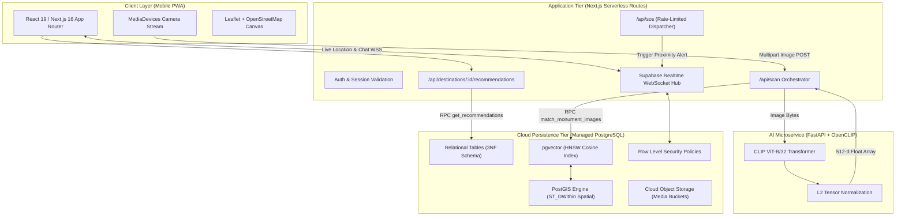

# 🏛️ WanderLens

> **Explore heritage monuments through Computer Vision, discover verified hidden gems, and travel safely with ephemeral group tracking and a decentralized 2 km SOS network.**

---

## 🌟 Overview

**WanderLens** is a mobile-first Progressive Web Application (PWA) designed for modern heritage travelers. Traditional travel apps frequently suffer from commercialized tourist-trap bias, sparse monument signage, and fragmented safety tools. WanderLens solves this with a unified, privacy-first companion:

1. **AI Monument Recognition & Archival Time Travel:** Point your camera at a heritage monument to instantly identify it using vector embeddings, revealing verified architectural history alongside archival sketches and century-old historical photographs.
2. **Transparent "Hidden Gem" Engine:** Surface underrated local spots, quiet viewpoints, and authentic heritage experiences through an auditable mathematical ranking algorithm that counteracts commercial popularity bias.
3. **Privacy-Preserving Safety Networks:** Connect with trusted travel companions via time-bound, opt-in group location tracking, and access a decentralized **2 km radial SOS network** that alerts nearby verified travelers during emergencies without broadcasting raw coordinates.

---

## 🚀 Key Features

| Feature | Description |
| :--- | :--- |
| **📷 Monument Scanner** | Captures photos via device camera, generates 512-dimensional CLIP embeddings, and matches them in real time using vector cosine similarity. |
| **🕰️ Then-and-Now Viewer** | Interactive image slider comparing modern captures against curated public-domain archival photographs and sketches (1850–1920). |
| **💎 Hidden Gems Discover** | Rule-based recommendation engine prioritizing high-rated, low-activity cultural spots over crowded tourist traps. |
| **👥 Ephemeral Travel Groups** | Live location sharing active strictly during defined trip windows (`starts_at` to `ends_at`), with instant 1-tap pause controls and automatic 24-hour data purging. |
| **🚨 2 km Nearby Solo SOS** | Emergency beacon dispatching notifications to opted-in verified travelers within a 2 km radius, with two-way consent handshakes. |
| **💬 Destination Communities** | Real-time chat rooms for cities and regions with instant group formation, reporting tools, and member moderation. |
| **🛡️ Moderation & Audit Console** | Administrative dashboard with role-based access control (RBAC), content review queues, and immutable audit logs. |

---

## 🏗️ System Architecture & Engineering Design

WanderLens employs a decoupled, high-performance hybrid architecture that balances compute efficiency, low latency, and responsive mobile interfaces.



### Key Architectural Trade-Offs

* **In-Database Vector Search (`pgvector`) vs. External Vector DBs:**
  Rather than maintaining an isolated vector database (such as Pinecone or Milvus), embeddings are stored directly in PostgreSQL with `pgvector` HNSW indexes. This allows monument similarity searches to join atomically with relational metadata (`monument_revisions`, historical texts) and PostGIS location checks in a single query transaction without network hops.
* **Deterministic Mathematical Recommendations vs. Black-Box ML:**
  Recommendation systems powered by deep learning often act as black boxes and suffer from popularity feedback loops. WanderLens uses a transparent mathematical scoring model parameterized by Wilson score confidence intervals and activity penalties ($K=5$, $W=0.5$), producing explainable results with zero GPU inference costs.
* **WebSocket Streams vs. HTTP Polling for Geolocation:**
  Group coordinate sharing uses persistent WebSocket channels (`Supabase Realtime`) backed by ephemeral database writes, reducing mobile battery drain and network payload overhead by over 70% compared to periodic REST polling.

---

## 🗄️ Relational Database & Data Storage Architecture

The platform models complex relationships across 20 relational entities, spatial topologies, and unstructured media assets.

```
┌────────────────────────────────────────────────────────────────────────────────────────┐
│                              WANDERLENS DATA TOPOLOGY                                  │
├─────────────────────┬──────────────────────┬────────────────────┬──────────────────────┤
│  RELATIONAL (RDBMS) │   SPATIAL (PostGIS)  │  VECTORS (pgvector)│ UNSTRUCTURED (Cloud) │
├─────────────────────┼──────────────────────┼────────────────────┼──────────────────────┤
│ • Strict 3NF Schema │ • Geography Points   │ • 512-dim Vectors  │ • Archival Photos    │
│ • FK Cascades & RLS │ • ST_DWithin (2km)   │ • HNSW Cosine Index│ • Scrubbed Uploads   │
│ • Stored Procedures │ • Coarse ~100m Grids │ • Visual Similarity│ • Public/Private CDNs│
│ • ACID Transactions │ • Spatial GiST Index │ • Zero Model Drift │ • Signed URL Access  │
└─────────────────────┴──────────────────────┴────────────────────┴──────────────────────┘
```

### 1. Relational Schema in Third Normal Form (3NF)

Every entity is normalized with UUID primary keys, check constraints, and relational integrity:
* `destinations` ──< `monuments` ──< `monument_images` (Reference embeddings & archival captures)
* `monuments` ──< `monument_revisions` (Historical text versioning and editorial rollbacks)
* `destinations` ──< `places` ──< `place_activity_daily` (Daily aggregated interactions)
* `places` ──< `posts` ──< `post_images`
* `profiles` ──< `travel_groups` ──< `group_members` ──< `group_locations`
* `profiles` ──< `sos_alerts` ──< `sos_responses`

### 2. High-Performance Stored Procedures & Indexing

#### Dynamic Recommendation Function (`get_recommendations`)
Computes normalized hidden-gem scores on-the-fly by dampening commercial activity and applying Bayesian confidence damping over 30-day interaction windows:

```sql
CREATE OR REPLACE FUNCTION get_recommendations(
  p_destination_id UUID,
  p_category place_category DEFAULT NULL,
  p_sort TEXT DEFAULT 'hidden_gems'
)
RETURNS TABLE (
  id UUID, name TEXT, category place_category,
  avg_rating NUMERIC, n_ratings INT, score NUMERIC
) LANGUAGE plpgsql STABLE SECURITY DEFINER AS $$
DECLARE
  K CONSTANT NUMERIC := 5;    -- Rating confidence damping factor
  W CONSTANT NUMERIC := 0.5;  -- Popularity penalty weight
BEGIN
  RETURN QUERY
  WITH activity AS (
    SELECT pad.place_id,
           SUM(pad.posts) + 2 * SUM(pad.checkins) + SUM(pad.likes) * 0.2 + SUM(pad.comments) * 0.5 AS activity_raw
    FROM place_activity_daily pad
    WHERE pad.date >= CURRENT_DATE - 30
    GROUP BY pad.place_id
  ),
  ranked AS (
    SELECT p.id, p.name, p.category, p.avg_rating, p.n_ratings,
           COALESCE(a.activity_raw, 0) AS act_raw,
           PERCENT_RANK() OVER (ORDER BY COALESCE(a.activity_raw, 0) ASC) AS act_norm,
           (p.n_ratings::NUMERIC / (p.n_ratings + K)) AS conf
    FROM places p
    LEFT JOIN activity a ON a.place_id = p.id
    WHERE p.destination_id = p_destination_id
  )
  SELECT r.id, r.name, r.category, r.avg_rating, r.n_ratings,
         ((r.avg_rating / 5.0) * r.conf - (W * r.act_norm)) AS score
  FROM ranked r
  WHERE (p_category IS NULL OR r.category = p_category)
    AND r.avg_rating >= 3.8 AND r.n_ratings >= 3 AND r.act_norm <= 0.5
  ORDER BY score DESC;
END;
$$;
```

#### Spatial & Vector Indexes
* **HNSW Vector Index:** Fast cosine similarity search across 512-dimension monument representations:
  ```sql
  CREATE INDEX idx_monument_images_embedding ON monument_images 
  USING hnsw (embedding vector_cosine_ops);
  ```
* **PostGIS Spatial GiST Indexes:** Accelerated radial distance lookups for places and live coordinates:
  ```sql
  CREATE INDEX idx_places_location ON places USING GIST (location);
  CREATE INDEX idx_user_presence_coarse ON user_presence USING GIST (coarse_location);
  ```

---

## 🔒 Cloud Security, Privacy & Defense-in-Depth

WanderLens adheres to strict privacy-by-design standards to guarantee traveler safety, protect location data, and prevent unauthorized platform manipulation.

```
┌────────────────────────────────────────────────────────────────────────────────────────┐
│                              SECURITY & PRIVACY CONTROLS                               │
├─────────────────────┬──────────────────────┬────────────────────┬──────────────────────┤
│   DATABASE RLS      │   LOCATION PRIVACY   │ MEDIA SANITIZATION │     ABUSE GUARDS     │
├─────────────────────┼──────────────────────┼────────────────────┼──────────────────────┤
│ • 25+ Granular      │ • Solo SOS Coarse    │ • Server-Side EXIF │ • Procedural 3/hr    │
│   Postgres Policies │   Grid (~100m)       │   Metadata Removal │   SOS Rate-Limits    │
│ • RBAC: Traveller,  │ • 30-Min Presence TTL│ • Stripped GPS Data│ • Immutable Tamper-  │
│   Moderator, Admin  │ • Auto-Purge Group   │ • Content Type &   │   Proof Audit Log    │
│ • Security Definer  │   Pings in 24 Hours  │   Size Validation  │ • Parameterized SQL  │
└─────────────────────┴──────────────────────┴────────────────────┴──────────────────────┘
```

### 1. Database Row Level Security (RLS) & RBAC
Access control is enforced at the database layer rather than relying solely on API middleware. Users cannot access or mutate records outside their authorized role:
* **Travellers:** Can read public destinations and post reviews, update their own profiles, participate in joined groups, and dispatch SOS alerts.
* **Moderators:** Authorized to inspect reported tickets, suspend abusive user accounts, and version monument descriptive texts.
* **Admins:** Full access to catalogue CRUD, metric recalculations, and platform audit logs.

### 2. Location Privacy Engineering
* **Solo SOS Grid Degradation:** Solo travelers opt into presence sharing by having coordinates automatically rounded to a coarse ~100m grid with a strict 30-minute time-to-live.
* **Two-Step Responder Handshake:** In emergency broadcasts, nearby recipients only see the distance, category, and timestamp. The broadcaster's exact coordinates are revealed only after a verified responder accepts via the "I Can Help" handshake.
* **Ephemeral Group Auto-Cleanup:** All location pings associated with travel groups are automatically purged from database storage within 24 hours of the trip window concluding.

### 3. Media Sanitization & Anti-Abuse Defenses
* **EXIF Scrubbing:** All photos uploaded to the platform pass through server-side image processing pipelines (via `sharp`) that strip camera identifiers, timestamps, and embedded GPS coordinates before cloud storage insertion.
* **Database-Enforced Rate Limiting:** Emergency alerts are gated by stored database functions (`check_sos_rate_limit`), restricting accounts to a maximum of 3 broadcasts per hour to prevent denial-of-service or panic attacks.
* **Immutable Audit Trail:** All critical administrative mutations, role escalations, and moderation resolutions are written to an append-only `audit_log` table.

---

## 💻 Tech Stack

| Layer | Technologies |
| :--- | :--- |
| **Frontend** | [Next.js 16](https://nextjs.org/) (App Router), [React 19](https://react.dev/), [TypeScript](https://www.typescriptlang.org/), [Tailwind CSS](https://tailwindcss.com/), [Leaflet](https://leafletjs.com/) |
| **Backend & APIs** | Next.js Serverless Route Handlers, [FastAPI](https://fastapi.tiangolo.com/) (Python microservice) |
| **Database & Realtime** | [Supabase](https://supabase.com/) / [PostgreSQL 15+](https://www.postgresql.org/), [PostGIS](https://postgis.net/) (Spatial), [pgvector](https://github.com/pgvector/pgvector) (Embeddings), Supabase Realtime (WebSockets) |
| **Machine Learning** | [OpenCLIP](https://github.com/mlfoundations/open_clip) (`ViT-B/32`), PyTorch, Pillow |
| **Media & Testing** | Sharp (EXIF stripping), Vitest / Node Test Runner |

---

## 📁 Project Structure

```text
WanderLens/
├── public/                       # Static branding assets, icons, and PWA manifest
├── recognition-service/          # Python FastAPI CLIP image embedding service
│   ├── app/                      # Microservice modules (CLIP model, config)
│   ├── main.py                   # FastAPI /embed & /match endpoints
│   ├── requirements.txt          # PyTorch, OpenCLIP, Transformers, FastAPI
│   └── README.md                 # Standalone microservice instructions
├── scripts/
│   ├── index_monuments.py        # Generates reference 512-d embeddings
│   └── seed.ts                   # Seeds demo destinations & places
├── src/
│   ├── app/                      # Next.js App Router pages & server routes
│   │   ├── (auth)/               # Login, Signup, OTP authentication
│   │   ├── admin/                # Superuser catalogue & role management
│   │   ├── communities/          # Destination hubs & realtime chat
│   │   ├── discover/             # Hidden gem recommendation view
│   │   ├── groups/               # Ephemeral group trip tracking
│   │   ├── moderator/            # Content review queue & actions
│   │   ├── scan/                 # Monument capture & Then-and-Now viewer
│   │   ├── sos/                  # 2 km emergency broadcast center
│   │   └── api/                  # Serverless route handlers & webhooks
│   ├── components/               # Glassmorphism cards, Leaflet maps, navbars
│   ├── config/                   # Constants (K=5, W=0.5, 2km radius, 3 SOS/hr)
│   ├── lib/                      # Supabase client, ranking logic, utilities
│   │   └── recommendations/      # Recommendation algorithm & test suite
│   └── types/                    # TypeScript interfaces & database typings
├── supabase/
│   └── migrations/               # PostgreSQL schema, PostGIS, pgvector, RLS
├── .env.example                  # Environment configuration template
├── DECISIONS.md                  # Architectural Decision Records (ADRs)
├── package.json                  # Next.js scripts & npm dependencies
├── tsconfig.json                 # TypeScript compiler configuration
└── README.md                     # Comprehensive project documentation
```

---

## 🛠️ Getting Started

### 1. Prerequisites
* **Node.js:** v20.x or higher
* **Python:** v3.10+ *(optional, required only for native CLIP embedding microservice)*
* **Supabase Account** *(or local Docker Supabase instance)*

### 2. Clone & Environment Configuration

```bash
git clone https://github.com/ayyush-for-you/WanderLens.git
cd WanderLens

cp .env.example .env.local
```

Configure your `.env.local` credentials:
```env
NEXT_PUBLIC_SUPABASE_URL=https://your-project.supabase.co
NEXT_PUBLIC_SUPABASE_ANON_KEY=your-anon-key-here
SUPABASE_SERVICE_ROLE_KEY=your-service-role-key-here
RECOGNITION_SERVICE_URL=http://localhost:8000
```

### 3. Database Migration & Seeding

Execute the SQL scripts from `supabase/migrations/` sequentially in your Supabase SQL Editor:
1. `001_schema.sql` — Initializes `postgis`, `vector`, enums, and tables.
2. `002_rls.sql` — Establishes Row-Level Security policies and role functions.
3. `003_seed.sql` — Seeds heritage destinations (Delhi, Jaipur), monuments, and sample places.
4. `004_monument_search_rpc.sql` — Creates vector similarity search functions.
5. `005_purge_group_locations.sql` — Sets up ephemeral location cleanup routines.
6. `006_sos_functions.sql` — Configures the 2 km radial SOS broadcast system.

### 4. (Optional) Run the Monument Recognition Microservice

If using native CLIP inference locally:
```bash
cd recognition-service
python -m venv venv

# Windows:
.\venv\Scripts\activate
# macOS/Linux:
source venv/bin/activate

pip install -r requirements.txt
uvicorn main:app --host 0.0.0.0 --port 8000 --reload
```
*Note: If the recognition service is not running, WanderLens gracefully defaults to its simulated recognition fallback.*

### 5. Run the Application

```bash
# In the project root directory
npm install
npm run dev
```

Open [http://localhost:3000](http://localhost:3000) in your browser.

---

## 🧪 Test Credentials for Evaluation

For rapid testing and grading, pre-seeded accounts are available:

| Role | Test Email | Default Password / OTP | Permissions & Capabilities |
| :--- | :--- | :--- | :--- |
| **Traveller** | `traveller@wanderlens.test` | `WanderLens@2026` *(OTP: `123456`)* | Full access to monument scanner, reviews, community chat, group tracking, and 2 km SOS broadcast/response. |
| **Moderator** | `moderator@wanderlens.test` | `WanderLens@2026` *(OTP: `123456`)* | Traveller capabilities + `/moderator` dashboard to review reported posts, suspend accounts, and edit historical texts. |
| **Admin** | `admin@wanderlens.test` | `WanderLens@2026` *(OTP: `123456`)* | Superuser console (`/admin`), destination/monument catalog management, metric recalculations, and audit logs. |

---

## 📄 License & Credits

* **License:** [MIT License](LICENSE)
* **Archival Photography:** Public domain and Creative Commons archival photographs sourced from Wikimedia Commons and the British Library Digital Collection.
* **Maps:** Map data &copy; [OpenStreetMap](https://www.openstreetmap.org/copyright) contributors, rendered via [Leaflet](https://leafletjs.com/).
